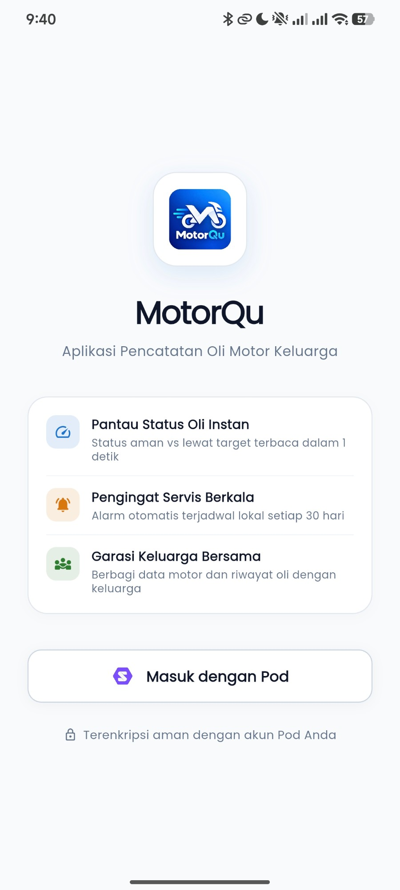
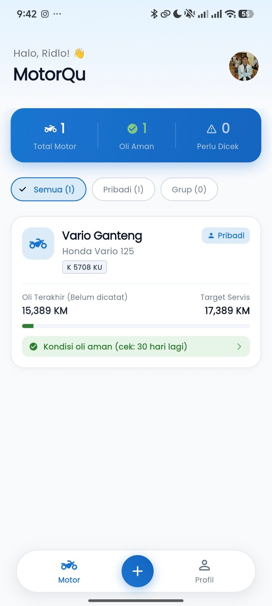
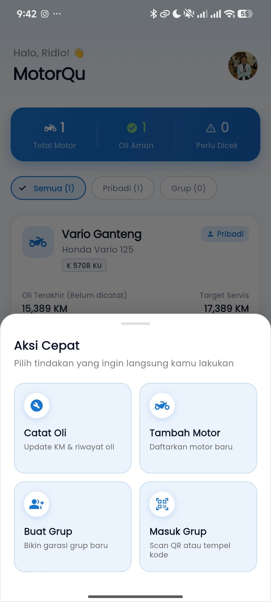
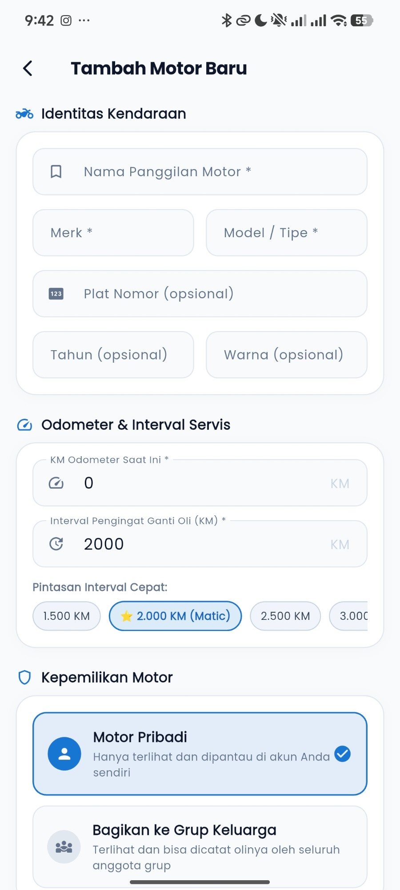
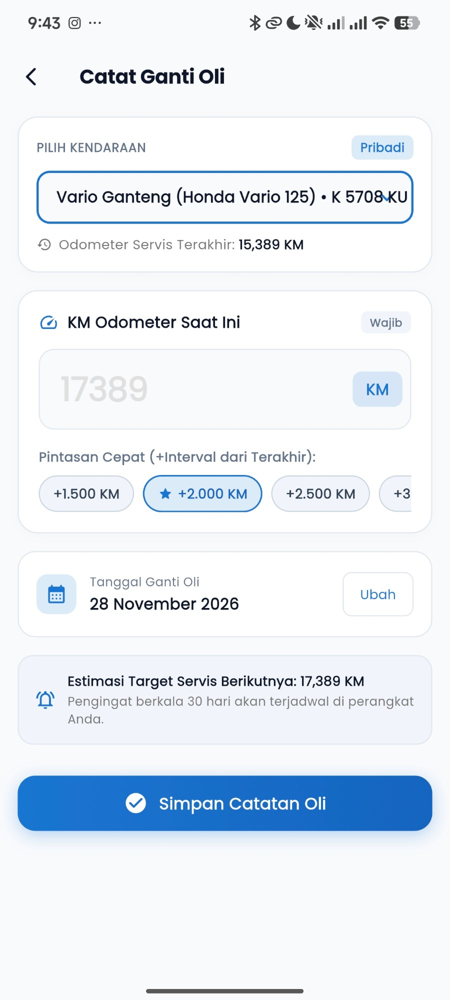
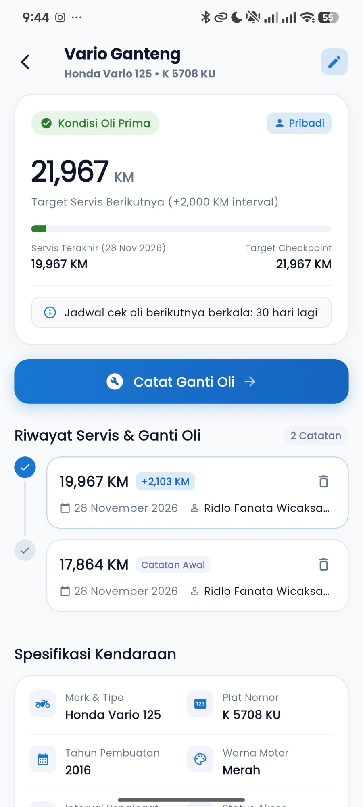
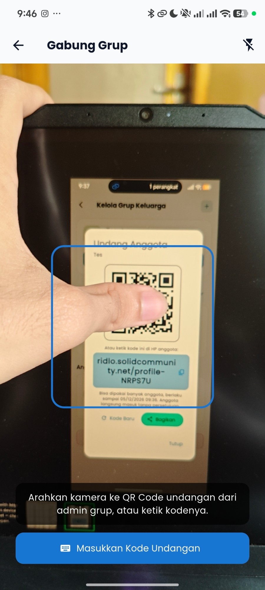
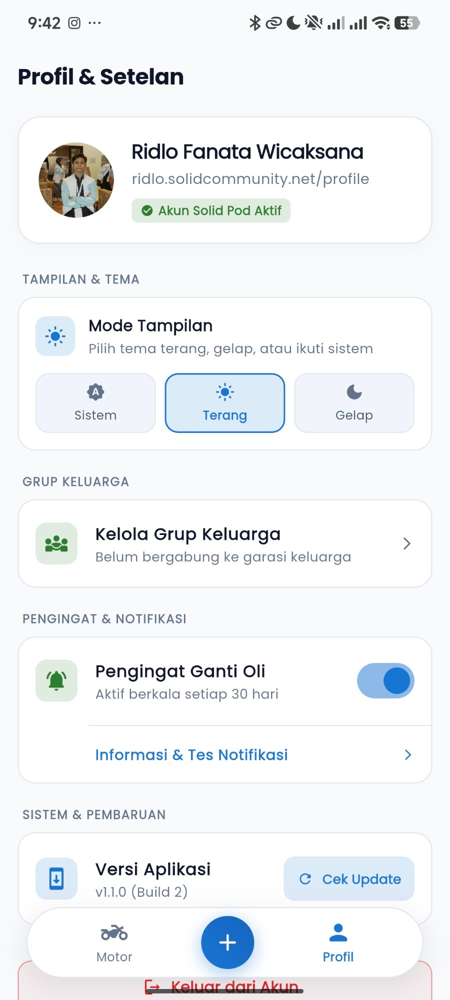

# MotorQu Solid

Aplikasi Android untuk mencatat ganti oli motor bersama keluarga. Seluruh
data disimpan di **Solid Pod** milik masing-masing pengguna, bukan di server
pusat: kamu yang memegang datamu, dan bebas memilih provider Pod.

## Coba Aplikasi

- 📥 **Unduh APK (Android 7.0+, ±107 MB):**
  https://github.com/JavierGavra/motorqu-solid/releases/latest/download/app-release.apk
- 💻 **Source code:** https://github.com/JavierGavra/motorqu-solid
- 🌐 **Halaman project:** https://javiergavra.github.io/motorqu-solid/

## Fitur

- Daftar motor pribadi & motor grup keluarga dalam satu beranda, lengkap
  dengan status oli (aman / perlu dicek) dan ringkasan garasi.
- Catat ganti oli (tanggal + KM), riwayat dengan selisih KM antar catatan,
  hapus catatan.
- Pengingat lokal 30 hari per motor, ketuk notifikasi langsung ke form oli.
- Grup keluarga: banyak grup, banyak owner/admin, undang lewat **QR** atau
  **kode undangan pendek** (mis. `ridlofw-K7M2QX`) yang bisa diketik,
  langsung masuk tanpa persetujuan, keluarkan anggota, bagikan / tarik motor.
- Auto-update APK dari GitHub Release, tema terang/gelap.

## Tampilan

<table>
  <tr>
    <td align="center" valign="top"><br><sub>Login ke Solid Pod</sub></td>
    <td align="center" valign="top"><br><sub>Beranda & ringkasan garasi</sub></td>
    <td align="center" valign="top"><br><sub>Menu aksi cepat</sub></td>
    <td align="center" valign="top"><br><sub>Tambah motor</sub></td>
  </tr>
  <tr>
    <td align="center" valign="top"><br><sub>Catat ganti oli</sub></td>
    <td align="center" valign="top"><br><sub>Detail motor & riwayat oli</sub></td>
    <td align="center" valign="top"><br><sub>Gabung grup: scan QR / ketik kode</sub></td>
    <td align="center" valign="top"><br><sub>Profil & setelan</sub></td>
  </tr>
</table>

## Instalasi

### Untuk pengguna (pasang APK)

1. Buka [link APK](https://github.com/JavierGavra/motorqu-solid/releases/latest/download/app-release.apk)
   di HP Android, lalu unduh `app-release.apk`.
2. Bila diminta, izinkan **Instal aplikasi tidak dikenal** untuk browser /
   file manager yang dipakai.
3. Buka file APK → **Instal** → buka **MotorQu**.
4. Daftar akun **Solid Pod** gratis di provider Solid mana pun, misalnya
   https://pods.solidcommunity.au (default di layar login) atau
   https://solidcommunity.net. Anggota satu grup **boleh memakai provider
   berbeda**.
5. Tekan **Masuk dengan Pod**. Bila akunmu bukan di provider default, ganti
   alamat server Pod-nya. Login dengan akun Pod, lalu izinkan akses aplikasi.
6. Izinkan **notifikasi** (pengingat ganti oli) dan **kamera** (scan QR
   undangan grup).

Versi baru dipasang lewat menu cek pembaruan di aplikasi, tanpa uninstall dan
tanpa kehilangan data (data ada di Pod, bukan di HP).

### Untuk developer (build dari source)

Kebutuhan: Flutter **3.47.7** (sama dengan CI), JDK 17, Android SDK.

```bash
git clone https://github.com/JavierGavra/motorqu-solid.git
cd motorqu-solid
flutter pub get
flutter run          # HP Android / emulator tersambung
flutter test
flutter analyze
```

Tidak perlu `android/key.properties`: tanpa keystore, build lokal otomatis
memakai debug key (lihat `android/app/build.gradle.kts`). Keystore rilis hanya
dipakai CI.

Ikon launcher dibuat dari `tool/launcher/` dengan:

```bash
dart run flutter_launcher_icons
```

## Cara kerja data di Solid Pod

Semua file Turtle (`.ttl`, tidak dienkripsi) berada di
`<pod>/motorqu-solid/data/`:

```
motorcycles/<motorId>/motorcycle.ttl        data motor
motorcycles/<motorId>/records/<id>.ttl      catatan ganti oli
groups/<groupId>.ttl                        data grup (di Pod host grup)
group_requests/<groupId>/                   permintaan bergabung (Append-only)
invites/<KODE>.ttl                          penunjuk kode undangan -> grup
joined_groups/<groupId>.ttl                 pointer ke grup yang diikuti
```

**Model akses**

- **Host grup** = pemilik Pod tempat `group.ttl` disimpan (pembuat grup).
  Hanya host yang bisa mengubah ACL file grup, jadi aplikasi host yang
  membuka akses untuk anggota baru (otomatis bila kode benar, tanpa
  persetujuan manual). Host baru bisa keluar setelah semua anggota lain
  dikeluarkan.
- **Kode undangan** = `<alamat Pod pembuat kode>-<6 karakter>`. Untuk server
  bawaan `pods.solidcommunity.au` alamatnya cukup nama akun (`ridlofw`);
  server lain memakai host/path Pod (`alice.solidcommunity.net-K7M2QX`).
  Kode menunjuk ke `invites/<KODE>.ttl` (hanya bisa dibaca user yang login &
  tahu kodenya), berlaku 7 hari untuk banyak anggota, dan QR berisi kode yang
  sama. Anggota yang masuk saat aplikasi host tidak berjalan melihat grup
  berstatus "menyinkronkan" sampai HP host membuka MotorQu.
- Setiap pemilik motor menulis ACL motornya sendiri sesuai anggota grup.
  ACL ditulis **utuh** (bukan ditambah), jadi kick / keluar / motor
  dijadikan pribadi otomatis mencabut akses saat aplikasi pemilik resource
  berjalan.
- Pointer grup & motor hanya dibuang dengan **bukti pasti** (404 asli, atau
  file grup terbaca tapi kita bukan anggota). 403 disembunyikan dulu dengan
  masa tenggang 7 hari.
- Perubahan file bersama memakai **ETag + `If-Match`** dengan retry saat
  konflik (HTTP 412), sehingga perubahan dari dua HP tidak saling menimpa.
- Tidak ada push realtime: data dimuat ulang saat aplikasi kembali aktif dan
  berkala selama aplikasi terbuka (beranda 2 menit, detail motor 45 detik,
  grup 2 menit). Sinkronisasi ACL di latar dibatasi 10 menit.

Kode terkait: `lib/services/pod_atomic.dart`, `access_policy.dart`,
`group_service.dart`, `app_refresh.dart`, `invite_codec.dart`.

## Batasan yang diketahui

- Pencabutan akses tidak seketika: menunggu aplikasi pemilik resource
  berjalan.
- Anggota yang masuk dengan kode saat aplikasi host grup tidak berjalan
  tetap berstatus "menyinkronkan" sampai host membuka MotorQu (hanya pemilik
  Pod yang bisa membuka akses data grup).
- Grup lama yang `ownerId`-nya sudah berpindah dari host (versi sebelum
  perbaikan ACL) tidak punya pengelola akses.
- Belum ada deep link yang bisa diklik dari WhatsApp (skema kustom tidak
  di-link-kan oleh WhatsApp; link https butuh hosting + `assetlinks.json`).
- Semua anggota keluarga perlu memakai versi aplikasi yang sama (QR/kode
  dari versi lama ditolak).

## Anggota Kelompok

| Nama | NIM |
|---|---|
| Ridlo Fanata Wicaksana | 26/591572/NPA/20034 |
| Javier Gavra Abhinaya | 26/592020/NPA/20050 |

## Untuk Maintainer

### Rilis

Setiap push ke `main` menjalankan `.github/workflows/build.yaml`: tes, build
APK release, lalu GitHub Release berisi `app-release.apk` + `latest.json`
(dibaca fitur auto-update di aplikasi). Push yang hanya mengubah file `*.md`
di root, `.gitignore`, atau `assets/screenshots/` tidak memicu build.

`README.md` juga menjadi halaman GitHub Pages. `client-profile.jsonld` dan
`redirect.html` di root dipakai login aplikasi: jangan dipindah/diubah.

1. **Naikkan `version` di `pubspec.yaml`** (angka setelah `+` = versionCode).
   Tanpa itu, HP pengguna tidak melihat ada pembaruan.
2. **Keystore rilis permanen** (sekali saja):

   ```powershell
   powershell -ExecutionPolicy Bypass -File scripts\create-release-keystore.ps1
   ```

   Lalu isi secret repository: `KEYSTORE_BASE64`, `KEYSTORE_PASSWORD`,
   `KEY_ALIAS`, `KEY_PASSWORD` (nama lama `ANDROID_*` juga diterima). CI
   sengaja gagal bila secret kosong, karena APK bertanda tangan debug key
   tidak bisa meng-update aplikasi yang sudah terpasang.
3. **Cadangkan keystore & password-nya.** Bila hilang, auto-update ke HP
   pengguna putus selamanya.

`applicationId` = `com.motorqu.solid`. Jangan diganti setelah rilis.

### Checklist uji manual (dua akun Pod)

Pakai akun Pod **uji**, bukan Pod keluarga: sinkronisasi pertama menulis
ulang ACL semua data. ACL lama dicetak di `adb logcat` dengan awalan
`[ACL] Menimpa`.

Siapkan HP **A** (host), HP **B** (anggota), dan bila ada HP **C**.

**Dasar**
- [ ] A: login, tambah motor pribadi, catat oli, hapus catatan.
- [ ] A: edit nama motor → tersimpan; KM oli tidak berubah.
- [ ] Log menampilkan `[PodAtomic] ... ETag: ...`. Bila `TANPA ETag`,
      penyimpanan tetap jalan tetapi tanpa perlindungan konflik.

**Grup & undangan**
- [ ] A: buat grup, buka QR undangan (biarkan terbuka). B: scan → langsung
      masuk.
- [ ] A: bagikan kode undangan lewat chat. C: Gabung → Masukkan Kode
      Undangan (ketik `namaakun-XXXXXX`) → grup tampil "menyinkronkan".
      A buka beranda → grup C aktif ≤ ±2 menit.
- [ ] Kode yang sama dipakai orang lain → ikut masuk. A: Kode Baru → kode
      lama ditolak ("tidak ditemukan").
- [ ] Izin kamera ditolak → layar scan menjelaskan penyebabnya, kode tetap
      bisa diketik.
- [ ] A: masukkan motor ke grup. B & C melihat motor itu dan bisa mencatat oli.
- [ ] B: masukkan motornya ke grup. A & C melihatnya setelah aplikasi B
      berjalan.

**Hak akses**
- [ ] B: Edit Motor milik A → bagian Kepemilikan terkunci, nama tetap bisa
      diubah.
- [ ] A: keluarkan C → C mendapat 403 ke grup; motor C kembali pribadi;
      A & B tetap punya akses.
- [ ] B: keluar grup → motor B kembali pribadi, A tidak lagi bisa membukanya
      (setelah aplikasi B berjalan).
- [ ] A (host) mencoba keluar saat masih ada anggota → ditolak dengan pesan
      jelas.

**Sinkronisasi & konflik**
- [ ] A di background ±1 menit, B mengubah data, A dibuka lagi → perubahan
      muncul dalam beberapa detik.
- [ ] Detail motor terbuka di A, B mencatat oli → muncul di A ≤ ±75 detik.
- [ ] A & B mengganti nama grup bersamaan → keduanya tersimpan tanpa error
      (salah satu menang, tidak ada data rusak).

**Rilis**
- [ ] Pasang APK versi N dari CI, lalu update ke N+1 lewat menu cek
      pembaruan → terpasang tanpa uninstall.
